# Retinal Disease Detection Using Deep Learning

### Automated Classification of Retinal OCT Images Using Custom CNN, EfficientNet-B0, Grad-CAM and Streamlit

An end-to-end Artificial Intelligence and Deep Learning project developed to classify retinal Optical Coherence Tomography (OCT) images into four categories: **CNV, DME, DRUSEN and NORMAL**.

The project covers the complete machine learning workflow, including data acquisition, exploratory data analysis, preprocessing, dataset splitting, model development, transfer learning, evaluation, explainable AI and interactive application development.

**GitHub Repository:** https://github.com/ssrikanthssk/Retinal_Disease_Detection

> **Medical Disclaimer:** This application is intended strictly for educational and research purposes. It is not a clinically validated diagnostic system and must not be used for medical decisions.

---

## 1. Project Overview

Retinal diseases can affect vision and may cause serious complications when they are not identified and managed appropriately.

Optical Coherence Tomography (OCT) is a non-invasive imaging technique that produces detailed cross-sectional images of retinal structures. These images are used by ophthalmologists to investigate abnormalities in retinal tissue.

Interpreting OCT images requires medical expertise. Deep learning provides an opportunity to study automated image classification methods that can identify visual patterns associated with different retinal conditions.

This project develops and compares two deep learning architectures:

1. **Custom Convolutional Neural Network (CNN)** — a baseline model developed and trained from scratch.
2. **EfficientNet-B0** — a pretrained convolutional neural network fine-tuned using transfer learning.

The best-performing validation model is integrated into a Streamlit application that supports OCT image upload, prediction visualization and Grad-CAM explanations.

### Main Project Features

- Four-class retinal OCT image classification.
- Exploratory data analysis and dataset visualization.
- Image preprocessing and augmentation.
- Group-aware training and validation splitting.
- Class imbalance handling.
- Custom CNN model training.
- EfficientNet-B0 transfer learning.
- GPU-accelerated training.
- Model evaluation using multiple classification metrics.
- Confusion matrix and classification report generation.
- Grad-CAM explainability.
- Interactive Streamlit dashboard.
- Saved model checkpoints and reproducible source code.

---

## 2. Problem Statement

Manual interpretation of retinal OCT images requires trained specialists and careful examination of retinal structures.

The objective of this project is to investigate whether deep learning models can automatically distinguish between common retinal OCT image categories.

The primary technical challenges include:

- Recognizing complex visual patterns in OCT images.
- Handling differences in image appearance and quality.
- Addressing unequal numbers of images across classes.
- Preventing unnecessary image distortion during preprocessing.
- Evaluating model performance beyond overall accuracy.
- Understanding where the model focuses when generating predictions.
- Creating an accessible interface for demonstrating model inference.

The project addresses these challenges through a structured deep learning pipeline.

---

## 3. Project Objectives

### Primary Objective

Develop a deep learning-based retinal OCT classification system capable of predicting one of four retinal image categories.

### Secondary Objectives

1. Acquire and explore a publicly available OCT dataset.
2. Analyze class distributions and image characteristics.
3. Develop a consistent image preprocessing pipeline.
4. Create training and validation datasets using group-aware splitting.
5. Train a Custom CNN as a baseline model.
6. Fine-tune EfficientNet-B0 using transfer learning.
7. Compare both architectures using consistent evaluation metrics.
8. Generate Grad-CAM heatmaps to visualize model attention.
9. Develop an interactive Streamlit application.
10. Document experimental results, limitations and future improvements.

---

## 4. Technology Stack

| Category | Technology | Purpose |
|---|---|---|
| Programming | Python | Main programming language |
| Deep Learning | PyTorch | Model development and training |
| Computer Vision | Torchvision | Pretrained models and image transformations |
| Data Processing | NumPy, Pandas | Data manipulation and analysis |
| Machine Learning | Scikit-learn | Dataset splitting and evaluation |
| Visualization | Matplotlib, Seaborn | Graphs and confusion matrices |
| Image Processing | Pillow, OpenCV | Image processing and visualization |
| Explainable AI | Grad-CAM | Model prediction interpretation |
| Web Application | Streamlit | Interactive dashboard |
| Dataset Management | Hugging Face Datasets | Dataset downloading and loading |
| Development | VS Code, Jupyter Notebook | Coding and experimentation |
| Version Control | Git, GitHub | Source code management |

### Development Hardware

- **Operating System:** Windows
- **GPU:** NVIDIA GeForce RTX 4050 Laptop GPU
- **GPU Memory:** 6 GB
- **Deep Learning Framework:** PyTorch with CUDA support
- **Python Version Used:** 3.11.9

GPU acceleration was used to make training more practical on the large image dataset.

---

## 5. Dataset Description

### Dataset Name

Kermany2017-OCT

### Dataset Source

https://huggingface.co/datasets/zacharielegault/Kermany2017-OCT

The dataset contains retinal OCT images grouped into four categories.

### Classification Categories

| Class | Full Name | Description |
|---|---|---|
| CNV | Choroidal Neovascularization | Abnormal blood vessel growth beneath the retina |
| DME | Diabetic Macular Edema | Retinal swelling associated with diabetes |
| DRUSEN | Drusen | Deposits that can occur beneath the retina |
| NORMAL | Normal | OCT images labeled as having normal retinal appearance |

These labels represent the dataset's classification categories. A prediction is not a medical diagnosis.

### Dataset Size

The original dataset contains:

- Training images: 108,309
- Test images: 1,000
- Total images: 109,309

### Original Training Class Distribution

| Class | Number of Images |
|---|---:|
| CNV | 37,205 |
| DME | 11,348 |
| DRUSEN | 8,616 |
| NORMAL | 51,140 |
| **Total** | **108,309** |

### Dataset Observations

The dataset is not balanced.

NORMAL and CNV contain substantially more training images than DME and DRUSEN.

This imbalance matters because a classification model may learn majority-class patterns more easily and may perform less reliably on minority classes.

To address this issue, the project uses class-weighted cross-entropy loss during training.

---

## 6. Exploratory Data Analysis (EDA)

Exploratory Data Analysis was performed to understand the dataset before model training.

### 6.1 Dataset Inspection

The initial analysis examined:

- Available dataset splits.
- Total image count.
- Class labels.
- Image dimensions.
- Image formats.
- Sample OCT images.
- Class distribution.
- Image quality characteristics.

### 6.2 Class Distribution Analysis

The number of images in each class was calculated and visualized.

This analysis identified class imbalance and helped motivate the use of weighted loss during training.

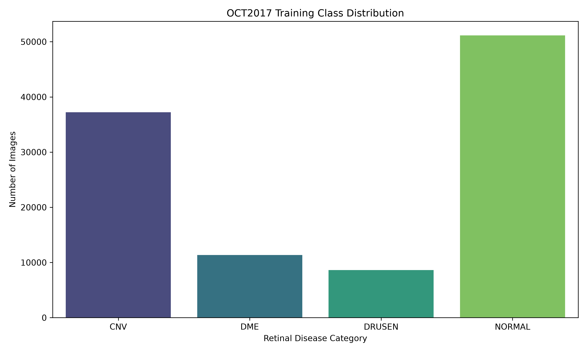

### 6.3 Sample Image Visualization

Representative OCT images were visualized to understand differences in retinal structures across the four categories.

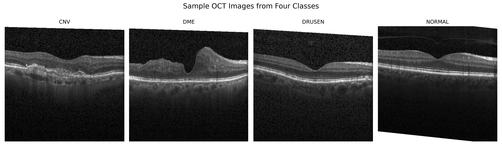

### 6.4 Image Dimension Analysis

Image dimensions were examined because medical imaging datasets can contain images with different heights and widths.

A consistent model input size was required for batch processing.

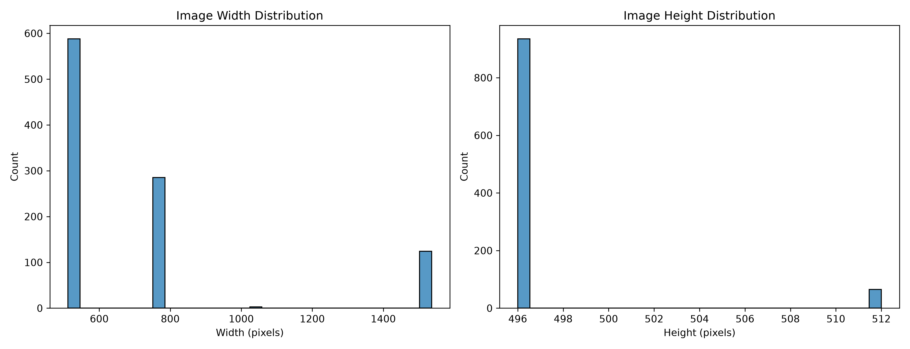

### 6.5 Image Quality Analysis

Image quality characteristics were explored to identify potential issues affecting model training.

These checks support understanding of the dataset but do not establish whether an image is clinically suitable.

### EDA Outputs

The project saves relevant visualizations and summaries in:

- `outputs/figures/`
- `outputs/metrics/`

The primary EDA notebooks are:

- `notebooks/01_OCT_dataset.ipynb`
- `notebooks/02_image_eda.ipynb`

---

## 7. Dataset Splitting

The original training dataset was divided into training and validation subsets.

A group-aware splitting strategy was used to reduce overlap between provisional identifiers extracted from image filenames.

### Final Dataset Distribution

| Split | Images | Purpose |
|---|---:|---|
| Training | 86,697 | Model parameter learning |
| Validation | 21,612 | Model selection and performance monitoring |
| Test | 1,000 | Separate evaluation and error analysis |
| **Total** | **109,309** | |

### Group-Aware Splitting

The project uses `GroupShuffleSplit` from Scikit-learn.

Instead of splitting images entirely at random, images sharing the same extracted grouping identifier are assigned to the same subset.

The split generation process evaluates candidate splits and selects one that balances the validation size and class distribution.

**Important limitation:** The extracted identifiers are provisional filename-derived identifiers and have not been independently verified as patient IDs. Therefore, this process should not be described as a clinically verified patient-level split.

The resulting indices are saved to:

`data/processed/split_indices.npz`

---

## 8. Image Preprocessing

Deep learning models require images in a consistent numerical format.

The preprocessing pipeline converts the original OCT images into tensors suitable for model training and inference.

### Step 1: RGB Conversion

OCT images may be represented as grayscale images.

They are converted to three-channel RGB format to match the input requirements of the selected neural network architectures.

### Step 2: Aspect-Ratio-Preserving Resize

Images are resized while preserving their original aspect ratio.

This reduces unnecessary geometric distortion of retinal structures.

### Step 3: Padding

Padding is applied to produce a final input size of:

**224 × 224 pixels**

### Step 4: Tensor Conversion

Images are converted into PyTorch tensors for numerical processing.

### Step 5: Normalization

The project uses ImageNet normalization:

**Mean:**

`[0.485, 0.456, 0.406]`

**Standard Deviation:**

`[0.229, 0.224, 0.225]`

Normalization helps align the input representation with the preprocessing used for ImageNet-pretrained models.

### Step 6: Data Augmentation

Limited color augmentation is applied during training.

This introduces small variations in image appearance to improve model robustness.

Augmentation is not applied to validation or test images.

### Preprocessing Visualization

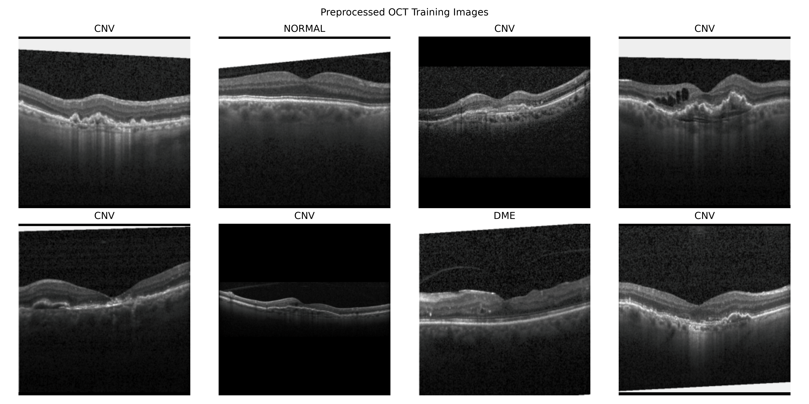

### Implementation

The preprocessing pipeline is implemented in:

`src/preprocessing.py`

The PyTorch dataset and data loaders are implemented in:

`src/dataset.py`

---

## 9. Deep Learning Model Development

Two architectures were developed and compared.

The purpose of this comparison was to determine whether transfer learning provides an advantage over a smaller custom architecture for this dataset.

### 9.1 Model 1: Custom CNN

A Convolutional Neural Network is designed to learn spatial patterns from images.

Convolutional layers extract local features such as edges, textures and more complex visual structures.

The Custom CNN was developed as a baseline.

#### Main Components

- Convolutional layers.
- Batch normalization.
- ReLU activation.
- Pooling operations.
- Fully connected classification layers.
- Four-class output layer.

#### Architecture Flow

```text
Input OCT Image
       |
       v
Image Preprocessing
       |
       v
Convolutional Feature Extraction
       |
       v
Batch Normalization + ReLU
       |
       v
Pooling and Deeper Feature Extraction
       |
       v
Classification Head
       |
       v
Four Output Scores
       |
       v
CNV / DME / DRUSEN / NORMAL
```

#### Model Details

- Architecture: Custom CNN
- Training approach: From scratch
- Parameters: Approximately 1.01 million
- Checkpoint: `models/best_cnn.pth`
- Checkpoint size: Approximately 3.88 MB

#### Why Use a Custom CNN?

The Custom CNN provides a baseline for evaluating the benefits of transfer learning.

It also demonstrates the process of designing, training and evaluating a convolutional architecture without using pretrained feature representations.

---

### 9.2 Model 2: EfficientNet-B0

EfficientNet-B0 is a convolutional neural network architecture designed to balance model accuracy and computational efficiency.

The project uses an EfficientNet-B0 model initialized with ImageNet-pretrained weights.

Its classification head is adapted to predict four retinal OCT categories.

#### Transfer Learning

Transfer learning uses representations learned from a previous dataset as a starting point for a new task.

In this project, EfficientNet-B0 starts with ImageNet-pretrained weights and is fine-tuned using retinal OCT images.

The model can adapt its learned visual features to the target classification task.

#### Architecture Flow

```text
Retinal OCT Image
        |
        v
Resize and Normalize
        |
        v
EfficientNet-B0 Feature Extractor
        |
        v
Learned Visual Features
        |
        v
Modified Classification Head
        |
        v
Four-Class Output
        |
        v
CNV / DME / DRUSEN / NORMAL
```

#### Model Details

- Architecture: EfficientNet-B0
- Initialization: ImageNet-pretrained weights
- Training approach: Transfer learning and fine-tuning
- Parameters: Approximately 4.01 million
- Checkpoint: `models/best_efficientnet.pth`
- Checkpoint size: Approximately 46.39 MB

The saved checkpoint includes training state information in addition to model parameters.

---

## 10. Model Training

Both models were trained using PyTorch.

### EfficientNet-B0 Training Configuration

| Parameter | Value |
|---|---|
| Batch Size | 8 |
| Maximum Epochs | 8 |
| Learning Rate | 0.0001 |
| Optimizer | AdamW |
| Weight Decay | 0.0001 |
| Loss Function | Weighted Cross-Entropy |
| Learning Rate Scheduler | ReduceLROnPlateau |
| Early Stopping Patience | 3 |
| Random Seed | 42 |
| Mixed Precision | Enabled on CUDA |
| Model Selection Metric | Validation Macro F1 |

### Training Process

**1. Load training data**

The data loader reads OCT images and applies preprocessing.

**2. Forward propagation**

Images pass through the neural network, producing four output scores.

**3. Calculate loss**

Weighted cross-entropy measures the difference between predicted outputs and ground-truth class labels.

**4. Backpropagation**

Gradients are calculated to determine how the model parameters should change.

**5. Update parameters**

AdamW updates model weights based on the calculated gradients.

**6. Validation**

After each epoch, the model is evaluated using the validation dataset.

**7. Checkpoint selection**

The model checkpoint is saved when validation macro F1 improves.

**8. Early stopping**

Training can stop when validation performance fails to improve for the configured patience period.

### Why Use Weighted Cross-Entropy?

The dataset contains unequal class frequencies.

Class weighting gives different importance to training errors from different categories, helping reduce the dominance of majority classes.

### Why Use Macro F1?

Accuracy measures the proportion of correctly classified images.

However, accuracy alone may hide weak performance on smaller classes.

Macro F1 gives equal importance to each class when averaging class-level F1 scores.

This makes it useful for evaluating an imbalanced classification dataset.

### Training Results

The best Custom CNN checkpoint was obtained at epoch 8.

The best EfficientNet-B0 checkpoint was obtained at epoch 7.

### Training Curves

**Custom CNN**

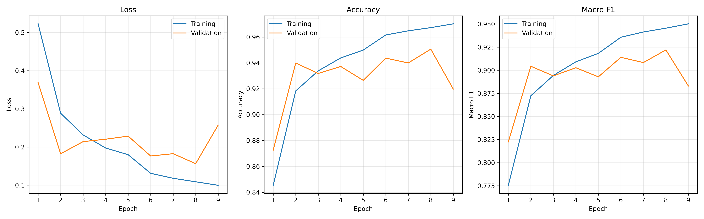

**EfficientNet-B0**

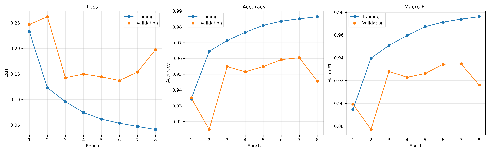

The training curves allow comparison of training and validation loss, accuracy and macro F1 across epochs.

---

## 11. Model Evaluation

Model evaluation was performed using several classification metrics.

### Accuracy

Accuracy measures the proportion of correctly classified images.

`Accuracy = Correct Predictions / Total Predictions`

### Precision

Precision measures how many predictions assigned to a class are correct.

`Precision = TP / (TP + FP)`

### Recall

Recall measures how many actual examples of a class are correctly identified.

`Recall = TP / (TP + FN)`

### F1 Score

The F1 score combines precision and recall using their harmonic mean.

`F1 = 2 × (Precision × Recall) / (Precision + Recall)`

### Balanced Accuracy

Balanced accuracy averages recall across classes, reducing the influence of class frequency.

### Confusion Matrix

A confusion matrix shows the number of correct and incorrect predictions for each class.

It helps identify which categories are commonly confused.

---

## 12. Model Performance Comparison

Both trained models were evaluated on the same validation split containing 21,612 images.

### Validation Performance

| Metric | Custom CNN | EfficientNet-B0 |
|---|---:|---:|
| Accuracy | 95.06% | **96.05%** |
| Balanced Accuracy | 93.34% | **93.82%** |
| Macro Precision | 91.21% | **93.17%** |
| Macro Recall | 93.34% | **93.82%** |
| Macro F1 | 92.19% | **93.47%** |

### Comparison Visualization

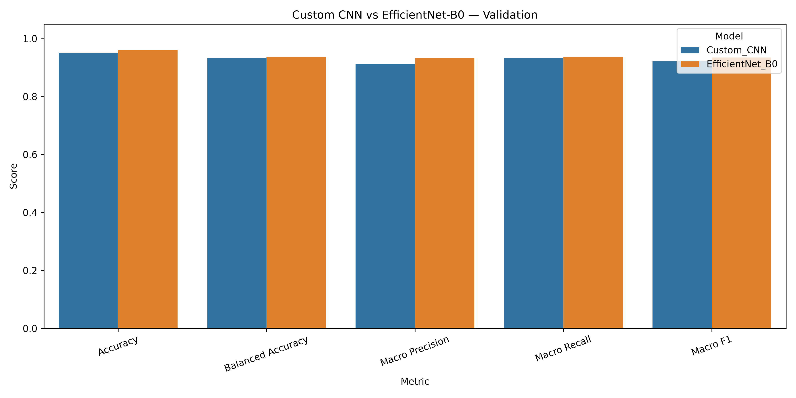

### Custom CNN Confusion Matrix

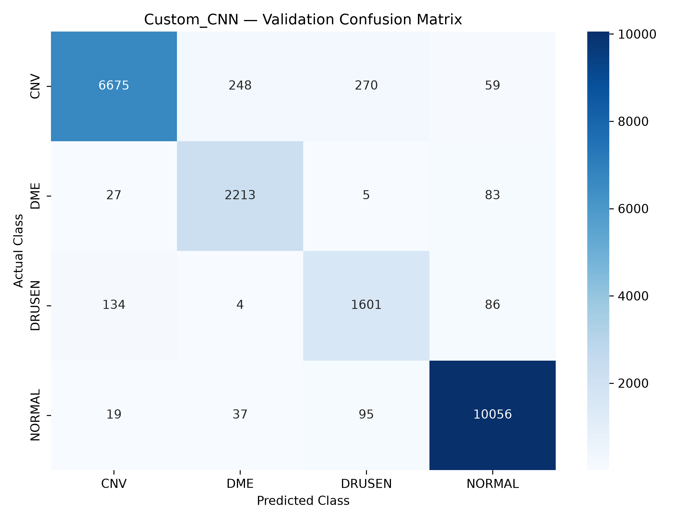

### EfficientNet-B0 Confusion Matrix

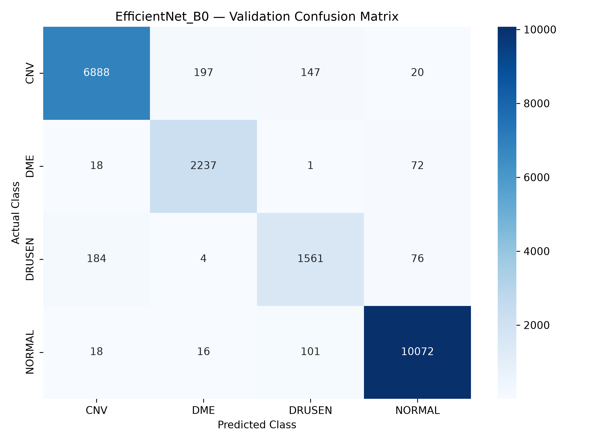

### Result Interpretation

EfficientNet-B0 achieved better validation accuracy and macro F1 than the Custom CNN.

The improvement in macro F1 indicates stronger overall class-balanced classification performance on the validation split.

For this reason, EfficientNet-B0 was selected for the Streamlit prediction dashboard.

**Important:** These results describe validation performance. They should not be interpreted as clinical accuracy or independent external test performance.

---

## 13. Additional Test-Set Evaluation

The Custom CNN was evaluated on the original 1,000-image test split.

### Custom CNN Test Results

| Metric | Result |
|---|---:|
| Test Accuracy | 89.00% |
| Macro F1 | Approximately 88.74% |

The test results were lower than the validation results.

One notable finding was weaker DRUSEN classification performance.

DRUSEN recall on this test evaluation was approximately 61%.

### Error Analysis

The analysis identified substantial confusion between DRUSEN and CNV.

This suggests that additional investigation is needed into class-specific visual similarities, dataset characteristics and model generalization.

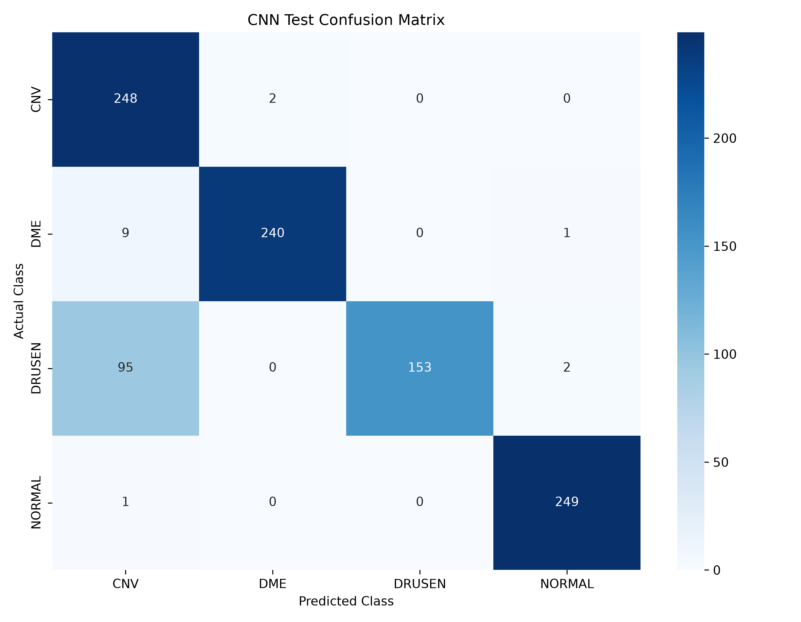

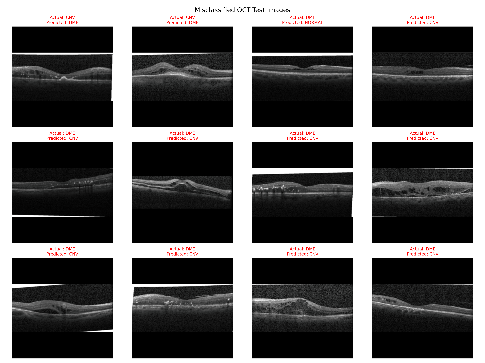

### Test-Set Limitation

The original test split was inspected during project development.

Therefore, further comparisons informed by this inspection should be treated as exploratory rather than as a completely untouched final test evaluation.

A new independent test dataset would be needed for stronger generalization claims.

---

## 14. Explainable AI Using Grad-CAM

Deep learning models can produce accurate predictions without directly explaining which image regions influenced those predictions.

To improve model interpretability, this project integrates Grad-CAM.

### What Is Grad-CAM?

Grad-CAM stands for Gradient-weighted Class Activation Mapping.

It produces a heatmap showing image regions that contributed to a selected class prediction.

### How Grad-CAM Works

1. An OCT image is passed through the trained model.
2. The model generates output scores.
3. Gradients are calculated for a selected class.
4. The gradients are used to weight feature maps from a convolutional layer.
5. The weighted feature maps are combined into a heatmap.
6. The heatmap is resized and overlaid on the original image.

### Grad-CAM Processing Flow

```text
Input OCT Image
       |
       v
EfficientNet-B0
       |
       v
Predicted Class
       |
       v
Gradient Calculation
       |
       v
Convolutional Feature Maps
       |
       v
Grad-CAM Heatmap
       |
       v
Heatmap Overlay
```

### Example Grad-CAM Results

**CNV**

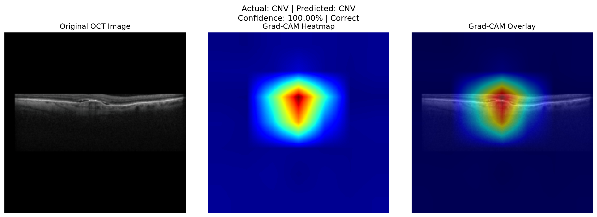

**DME**

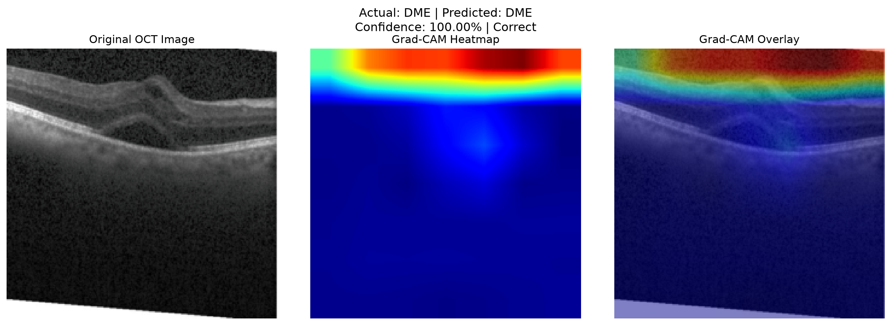

**DRUSEN**

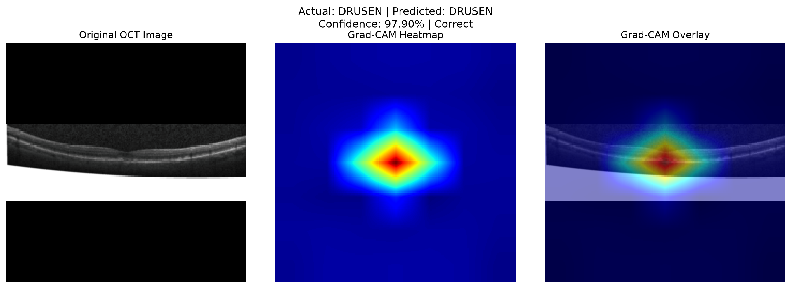

**NORMAL**

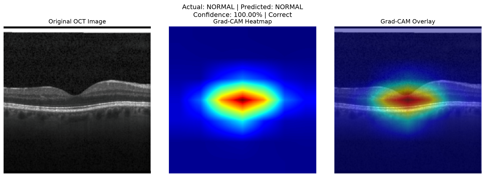

### Benefits

- Provides visual information about model attention.
- Supports qualitative investigation of predictions.
- Helps inspect whether the model relies on unexpected image regions.
- Improves transparency when demonstrating model behavior.

### Limitations

Grad-CAM does not prove that the model identified medically relevant abnormalities.

Heatmaps should be interpreted as approximate model explanations, not clinical evidence.

---

## 15. Streamlit Web Application

A Streamlit dashboard was developed to provide an interactive interface for demonstrating the trained model.

The application is implemented in:

`app.py`

### Dashboard Components

The application contains three main tabs.

### 15.1 Prediction Dashboard

Users can upload a retinal OCT image in a supported format.

The application then:

1. Loads the image.
2. Applies the preprocessing pipeline.
3. Loads the trained EfficientNet-B0 model.
4. Performs model inference.
5. Displays the predicted class.
6. Shows the model's confidence score.
7. Displays class-wise prediction scores.
8. Generates a Grad-CAM visualization.
9. Allows downloading a JSON prediction summary.

### 15.2 Model Performance Dashboard

This section presents saved model evaluation results.

Features include:

- Custom CNN and EfficientNet-B0 comparison.
- Validation accuracy.
- Precision, recall and macro F1.
- Performance visualization.
- Downloadable model comparison data.

### 15.3 About Project

This section explains:

- Project objectives.
- Dataset information.
- Retinal OCT classification categories.
- Deep learning models.
- Technology stack.
- Research limitations.

### Prediction Confidence

The dashboard displays scores derived from the model's outputs.

These scores should not be interpreted as calibrated medical probabilities.

---

## 16. Project Directory Structure

```text
Retinal_Disease_Detection/
|
|-- app.py
|-- README.md
|-- requirements.txt
|-- .gitignore
|
|-- data/
|   |-- raw/
|   |-- processed/
|
|-- models/
|   |-- best_cnn.pth
|   |-- best_efficientnet.pth
|
|-- notebooks/
|   |-- 01_OCT_dataset.ipynb
|   |-- 02_image_eda.ipynb
|
|-- src/
|   |-- __init__.py
|   |-- download_dataset.py
|   |-- create_splits.py
|   |-- preprocessing.py
|   |-- dataset.py
|   |-- model.py
|   |-- efficientnet_model.py
|   |-- train.py
|   |-- train_efficientnet.py
|   |-- evaluate.py
|   |-- compare_models.py
|   |-- gradcam.py
|
|-- outputs/
|   |-- figures/
|   |   |-- gradcam/
|   |
|   |-- metrics/
|   |-- predictions/
|
|-- export_samples.py
|-- check_libraries.py
|-- test_dataloader.py
|-- test_gpu.py
```

The `data/raw/` and `data/processed/` directories are excluded from GitHub.

Large generated prediction files are also excluded from version control.

Some directories may only appear after downloading the dataset or running the corresponding scripts.

---

## 17. Installation and Setup

### Prerequisites

- Python 3.11 or another compatible version.
- Git.
- Internet connection for downloading dependencies and the dataset.
- Sufficient disk space for the OCT dataset.
- NVIDIA GPU recommended for training, but not required for basic inference.

### Step 1: Clone the Repository

```bash
git clone https://github.com/ssrikanthssk/Retinal_Disease_Detection.git
cd Retinal_Disease_Detection
```

### Step 2: Create a Virtual Environment

```bash
python -m venv venv
```

### Step 3: Activate the Environment

Windows PowerShell:

```powershell
.\venv\Scripts\Activate.ps1
```

If PowerShell blocks activation, the following can be used for the current terminal session:

```powershell
Set-ExecutionPolicy -Scope Process -ExecutionPolicy Bypass
.\venv\Scripts\Activate.ps1
```

### Step 4: Install Dependencies

```bash
python -m pip install --upgrade pip
python -m pip install -r requirements.txt
```

For GPU acceleration, install a compatible CUDA-enabled PyTorch build using the official PyTorch installation instructions:

https://pytorch.org/get-started/locally/

### Step 5: Run the Streamlit Application

```bash
python -m streamlit run app.py
```

The application normally opens at:

http://localhost:8501

### Step 6: Test the Application

1. Open the Prediction Dashboard.
2. Upload an OCT image.
3. View the predicted class.
4. Examine the class-wise scores.
5. Generate the Grad-CAM visualization.
6. Explore the Model Performance tab.

The repository includes trained checkpoints, so retraining is not required for basic dashboard inference.

---

## 18. Reproducing the Training Workflow

Retraining requires downloading the dataset and recreating the preprocessing and split artifacts.

### Step 1: Download the Dataset

```bash
python -m src.download_dataset
```

The dataset is saved to:

`data/raw/oct2017/`

### Step 2: Run EDA

Open and execute the notebooks:

```text
notebooks/01_OCT_dataset.ipynb
notebooks/02_image_eda.ipynb
```

The EDA workflow generates metadata and analysis outputs.

### Step 3: Create Training and Validation Splits

After generating the required metadata file:

```bash
python -m src.create_splits
```

The split indices are saved to:

`data/processed/split_indices.npz`

### Step 4: Train the Custom CNN

```bash
python -m src.train
```

The best checkpoint is saved to:

`models/best_cnn.pth`

### Step 5: Train EfficientNet-B0

```bash
python -m src.train_efficientnet
```

The best checkpoint is saved to:

`models/best_efficientnet.pth`

### Step 6: Evaluate the Custom CNN

```bash
python -m src.evaluate
```

### Step 7: Compare the Models

```bash
python -m src.compare_models
```

### Step 8: Generate Grad-CAM Visualizations

```bash
python -m src.gradcam
```

### Step 9: Export Sample Images

```bash
python export_samples.py
```

### Step 10: Launch the Dashboard

```bash
python -m streamlit run app.py
```

**Reproducibility note:** Training depends on the dataset, generated metadata, split indices, compatible dependencies and hardware configuration. Exact results may vary across environments. The complete training workflow has not been independently verified in a fresh cloned environment.

---

## 19. Saved Models and Outputs

### Model Checkpoints

| Model | File | Approximate Size |
|---|---|---:|
| Custom CNN | `models/best_cnn.pth` | 3.88 MB |
| EfficientNet-B0 | `models/best_efficientnet.pth` | 46.39 MB |

### Important Evaluation Files

| File | Description |
|---|---|
| `outputs/metrics/model_comparison.csv` | Validation model comparison |
| `outputs/metrics/training_history.csv` | Custom CNN training history |
| `outputs/metrics/efficientnet_training_history.csv` | EfficientNet training history |
| `outputs/metrics/classification_report.csv` | Custom CNN test classification report |
| `outputs/metrics/test_metrics.json` | Custom CNN test metrics |
| `outputs/figures/model_comparison.png` | Model comparison chart |
| `outputs/figures/training_curves.png` | Custom CNN training curves |
| `outputs/figures/efficientnet_training_curves.png` | EfficientNet training curves |

Additional confusion matrices, Grad-CAM outputs and analysis figures are available in the corresponding output directories.

---

## 20. Key Findings

### Finding 1: Transfer Learning Improved Validation Performance

EfficientNet-B0 achieved higher validation accuracy and macro F1 than the Custom CNN.

This supports selecting EfficientNet-B0 for the project dashboard.

### Finding 2: Class Imbalance Is Important

The dataset contains substantially different class frequencies.

Weighted loss was incorporated to help address this imbalance.

### Finding 3: Overall Accuracy Is Not Sufficient

The Custom CNN achieved strong validation accuracy, but its test-set error analysis revealed weaker DRUSEN recall.

This demonstrates why class-specific precision, recall, F1 scores and confusion matrices are important.

### Finding 4: Explainability Adds Useful Context

Grad-CAM provides visual information about which regions contributed to a prediction.

This is useful for model investigation, although it does not establish clinical correctness.

### Finding 5: Deployment Makes the Project Accessible

The Streamlit application combines model inference, visual explanations and saved performance results in one interactive interface.

---

## 21. Project Limitations

This project has several important limitations.

### Dataset Generalization

The trained models were developed using a specific public OCT dataset.

Performance may differ on images collected using other devices, clinical settings or patient populations.

### Unverified Group Identifiers

The group-aware split uses identifiers extracted from filenames.

These identifiers have not been independently confirmed to represent unique patients.

### Model Selection Bias

The validation split was used for checkpoint selection and model comparison.

Reported validation results are therefore not equivalent to independent test performance.

### Test-Set Inspection

The original test split was examined during development.

A new untouched external dataset is required for stronger generalization evaluation.

### Confidence Calibration

Model output scores are not necessarily calibrated probabilities.

A high confidence score does not guarantee that a prediction is correct.

### Explainability Limitations

Grad-CAM heatmaps are approximate explanations of model behavior.

They do not validate medical reasoning.

### Clinical Limitations

The system has not undergone clinical validation, regulatory review or prospective testing.

It must not be used as a diagnostic tool.

---

## 22. Future Enhancements

Potential improvements include:

1. Evaluate EfficientNet-B0 on an independent external test dataset.
2. Improve DRUSEN classification performance.
3. Investigate additional deep learning architectures.
4. Perform model confidence calibration.
5. Conduct cross-device and cross-institution validation.
6. Compare additional explainability methods.
7. Introduce stronger model monitoring and reproducibility checks.
8. Optimize model inference for deployment.
9. Add automated testing and continuous integration.
10. Improve documentation and deployment instructions.

---

## 23. Learning Outcomes

This project demonstrates practical experience with:

- Deep learning project development.
- Medical image dataset exploration.
- Data preprocessing and augmentation.
- Dataset splitting strategies.
- PyTorch model implementation.
- Convolutional Neural Networks.
- Transfer learning.
- GPU training and mixed precision.
- Model checkpointing.
- Classification metrics and error analysis.
- Explainable AI using Grad-CAM.
- Streamlit application development.
- Git and GitHub version control.
- Technical documentation.

---

## 24. Conclusion

This project presents an end-to-end deep learning workflow for retinal OCT image classification.

Two architectures were developed and evaluated: a Custom CNN and EfficientNet-B0.

EfficientNet-B0 achieved the strongest validation results, with approximately **96.05% validation accuracy and 93.47% validation macro F1**.

The project also demonstrates the importance of class-specific evaluation, error analysis and explainability.

Grad-CAM was incorporated to provide visual explanations of model predictions, and a Streamlit application was developed to make the trained model accessible through an interactive interface.

Although the experimental results are promising for an educational machine learning project, further independent testing and clinical validation would be required before considering any medical application.

---

## 25. Dataset Attribution and Licensing

**Dataset:** Kermany2017-OCT

**Source:** https://huggingface.co/datasets/zacharielegault/Kermany2017-OCT

The dataset belongs to its respective owners and contributors. Users should review the original dataset documentation and licensing terms before redistribution or commercial use.

No software license is declared in this repository unless a separate `LICENSE` file is added.

---

## 26. Repository

**Project:** Retinal Disease Detection Using Deep Learning

**GitHub:** https://github.com/ssrikanthssk/Retinal_Disease_Detection

**Domain:** Artificial Intelligence, Deep Learning, Computer Vision and Medical Image Analysis

**Application:** Research and Educational Demonstration

---

**Developed as an end-to-end AI/ML project demonstrating retinal OCT image classification, transfer learning, model evaluation, explainable AI and interactive deployment.**
